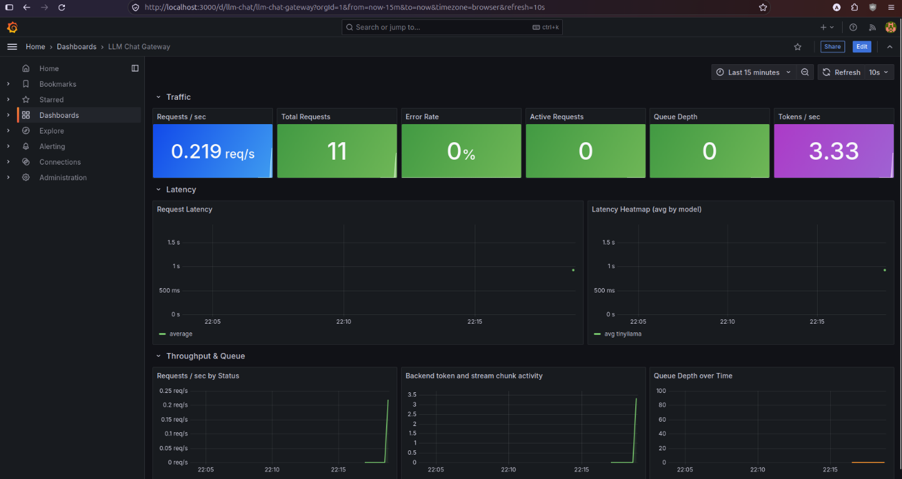
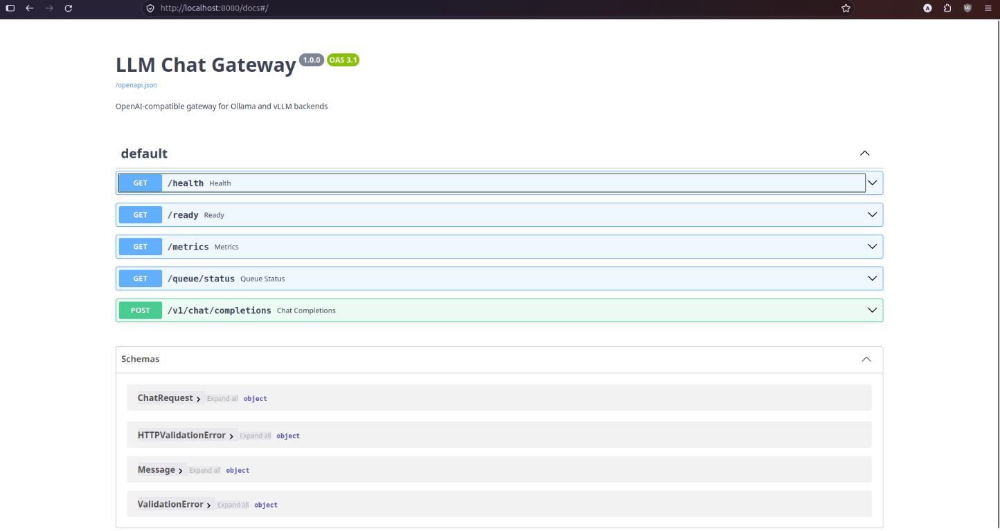
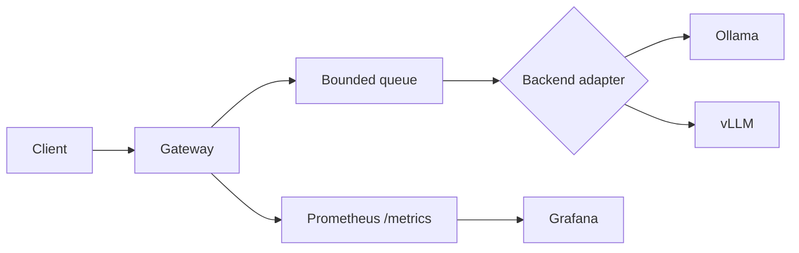

# OpenAI LLM Gateway

An OpenAI-compatible FastAPI gateway that puts bounded concurrency, rate limiting, metrics, and request cancellation in front of Ollama or a vLLM adapter tested with a mocked backend.

[](https://github.com/Hassnain2003/openai-llm-gateway/actions/workflows/ci.yml)
[](https://www.python.org/)
[](LICENSE)



*Grafana dashboard populated from the local Compose stack.*



*FastAPI Swagger UI for the gateway endpoints.*

## 60-second quick start

Requirements: Python 3.11+, Docker Compose, and an Ollama model if you run the local backend yourself.

```bash
git clone https://github.com/Hassnain2003/openai-llm-gateway.git
cd openai-llm-gateway
pip install -r requirements.txt
make test
```

Run the gateway against a local Ollama instance:

```bash
MODEL_BACKEND_URL=http://localhost:11434 MODEL_NAME=tinyllama \
  uvicorn gateway.main:app --host 0.0.0.0 --port 8080
```

The gateway reads these environment variables (the same names are used by
`docker-compose.yml`, Helm templates, and the Kubernetes manifests):

| Variable | Purpose | Default |
|---|---|---|
| `MODEL_BACKEND_URL` | Ollama or vLLM-compatible backend URL | `http://localhost:11434` |
| `MODEL_NAME` | Model identifier sent to the backend | `tinyllama` |
| `BACKEND_TYPE` | Backend adapter: `ollama` or `vllm` | `ollama` |
| `RATE_LIMIT_PER_MINUTE` | Per-IP fallback request limit | `60` |
| `API_KEYS` | JSON object mapping API keys to per-minute limits | empty |
| `QUEUE_MAX_DEPTH` | Maximum in-process queue depth | `100` |
| `REQUEST_TIMEOUT` | Backend request timeout in seconds | configured in `gateway/config.py` |

Then call the OpenAI-compatible endpoint:

```bash
curl -s http://localhost:8080/v1/chat/completions \
  -H 'Content-Type: application/json' \
  -d '{"model":"tinyllama","messages":[{"role":"user","content":"Say hello."}]}'
```

For the complete local stack (gateway, Ollama, Prometheus, and Grafana), use:

```bash
make dev
```

The gateway is at `http://localhost:8080`, Prometheus at `http://localhost:9090`, and Grafana at `http://localhost:3000` (`admin`/`admin`). The Compose Ollama service does not automatically download a model; pull the configured model with `docker compose exec ollama ollama pull tinyllama`.

## What is implemented

- OpenAI-compatible `POST /v1/chat/completions` for non-streaming and SSE streaming responses.
- Ollama and a vLLM adapter tested with a mocked backend, selected by `BACKEND_TYPE`.
- A bounded in-process request queue. Full capacity returns `503` with `Retry-After`.
- Token-bucket rate limiting: configured API keys use their own limits; requests without a configured key use the client IP fallback.
- `Retry-After` on rate-limit responses, request IDs in `X-Request-ID`, and JSON request-completion logs.
- Request timeout and client-disconnect cancellation, with queue-slot cleanup.
- Prometheus metrics at `/metrics`, including queue depth, cancellation/timeout counts, time-to-first-chunk, and the latest streaming chunks/sec.
- `/health`, `/ready`, and `/queue/status` endpoints.
- Helm templates for CPU/Ollama and GPU/vLLM deployment, raw Kubernetes manifests, and Terraform for the optional EKS path.

### API-key configuration

`API_KEYS` is a JSON object mapping keys to requests per minute:

```bash
API_KEYS='{"reviewer-key":30,"service-key":60}' \
  uvicorn gateway.main:app --host 0.0.0.0 --port 8080
```

Use either `X-API-Key: reviewer-key` or `Authorization: Bearer reviewer-key`. An unknown key is treated as an IP-fallback request; this project does not provide user provisioning or persistent distributed rate-limit storage.

### Streaming

```bash
curl -N -s http://localhost:8080/v1/chat/completions \
  -H 'Content-Type: application/json' \
  -d '{"model":"tinyllama","stream":true,"messages":[{"role":"user","content":"Count to three."}]}'
```

## Architecture



The gateway listens on pod port `8080`. Kubernetes Services expose it on port `80` and name the target port `http`; the ServiceMonitor scrapes that named service port at `/metrics`.

See [ARCHITECTURE.md](ARCHITECTURE.md) for the design decisions and known limitations.

## Repository layout

- `gateway/`: FastAPI application, adapters, queue, limiter, and metrics.
- `tests/`: gateway unit and endpoint tests.
- `chart/`: Helm chart and CPU/GPU values files.
- `k8s/`: raw Kubernetes manifests and monitoring resources.
- `infra/`: optional EKS Terraform configuration.
- `loadtest/`: k6 scenarios for limiter, capacity, overload, and direct baseline runs.
- `docs/`: benchmark output instructions and screenshot TODOs.
- `.github/workflows/`: CI workflow.
- `scripts/`: load-test runners and result renderers.
- `docs/results.md`: recorded load-test and baseline results.
- `tests/mock_backend/`: tiny mock backend used by the kind CI smoke test.
- `docker-compose.yml`, `docker-compose.loadtest.yml`: local and load-test stacks.
- `loadtest/`: k6 scenarios for limiter, capacity, overload, and direct baseline runs.

## Local Kubernetes

The no-cloud path uses kind (or an equivalent local Kubernetes cluster):

```bash
make kind-up
make kind-deploy
make kind-test
```

`make kind-test` runs against the checked-in mock backend, not a real model. That mock-backend
deployment verified the Kubernetes health endpoint, readiness endpoint, non-streaming path,
streaming path, and zero gateway restarts. It does not verify model inference in Kubernetes.
The optional HPA and custom-metrics path was not verified. The EKS/GPU path is a deployment
starting point, not a claim that AWS resources were applied:

```bash
helm upgrade --install llm-chat ./chart \
  -f chart/values.yaml -f chart/values-gpu.yaml
```

The default Helm values use a 60 requests-per-minute limit and port `8080`. Local overrides use the same limit:

```bash
helm upgrade --install llm-chat ./chart -f chart/values-local.yaml
```

## Benchmarks

The benchmark harness has four scenarios plus one aggregate command:

- `make loadtest-limiter`: limiter verification, not a performance benchmark.
- `make loadtest-baseline`: direct Ollama baseline, bypassing the gateway.
- `make loadtest-capacity`: CPU-only capacity stages at 1, 2, 4, 8, and 16 virtual users.
- `make loadtest-overload`: queue overload verification with a queue depth of 4.
- `make loadtest`: runs all four commands in order and writes separate sections to [docs/results.md](docs/results.md).

Capacity uses fixed prompts, `max_tokens: 64`, a 15-second warm-up request, and a raised rate limit. Latency and token-rate columns include only 2xx responses. Capacity numbers describe gateway behavior around a CPU-only 1.1B model on the recorded hardware; they are not a claim about model speed.

### Measured results

The following tables were generated by the exact commands shown below each table. Hardware for
every table: Intel(R) Core(TM) i5-8365U CPU @ 1.60GHz, 8 cores, 14 GiB RAM, no GPU. Model:
`tinyllama`, Q4_0, 1.1B.

Limiter verification, not a performance benchmark (`make loadtest-limiter`):

| 200 | 429 | 429 without `Retry-After` | key-b 200 |
|---:|---:|---:|---:|
| 4 | 8 | 0 | 2 |

Capacity runs (`make loadtest-capacity` and `make loadtest-capacity RUN_LABEL=run-2`), with
100,000 requests/minute and queue depth 1,000. Values below are the min-max ranges across
the two recorded runs in [docs/results.md](docs/results.md):

| VUs | Successful req/s | Completion tokens/s | p50 latency (ms) | p95 latency (ms) | p99 latency (ms) |
|---:|---:|---:|---:|---:|---:|
| 1 | 0.483-0.600 | 12.267-14.200 | 1382.478-1663.094 | 3724.343-4753.595 | 4526.889-5273.814 |
| 2 | 0.550-0.600 | 13.650-15.833 | 2918.898-3363.906 | 7348.003-8366.191 | 7832.565-9101.060 |
| 4 | 0.933-1.167 | 20.250-24.750 | 3352.618-4099.842 | 6041.830-8571.046 | 10223.604-12984.022 |
| 8 | 1.083-1.167 | 23.083-26.667 | 6573.122-7782.490 | 11542.301-11688.041 | 12449.040-13994.742 |
| 16 | 1.167-1.383 | 26.467-29.317 | 13059.724-15136.064 | 17273.361-21067.354 | 18108.060-22043.396 |

Run 1 recorded 29-70 successful non-streaming requests by stage and 58 successful streams;
run 2 recorded 36-83 successful non-streaming requests by stage and 61 successful streams.
The streaming histogram recorded p50 `0.5s` and p95 values of `10s` and `7.5s` for
`llm_chat_time_to_first_chunk_seconds` in runs 1 and 2, respectively.

Queue overload verification (`make loadtest-overload`), with 100,000 requests/minute and
queue depth 4:

| 200 | 503 | Other | 503 without `Retry-After` | Maximum queue depth |
|---:|---:|---:|---:|---:|
| 21 | 8393 | 0 | 0 | 4.0 |

These results are also preserved in [docs/results.md](docs/results.md), including UTC dates and
the git commit used for each run. Capacity numbers are for a CPU-only 1.1B model on this
hardware and are meant to show gateway behavior, not model speed. A run with more than 1%
non-2xx responses must be treated as a limiter or overload test, not a latency benchmark.

### Baseline comparison

The direct baseline uses Ollama's native `/api/chat`; the gateway uses
`/v1/chat/completions`. Differences are within run-to-run variance and are not a pure
gateway-overhead measurement.

| Run | VUs | Gateway req/s | Direct Ollama req/s | Difference | Gateway p50 (ms) | Direct Ollama p50 (ms) |
|---:|---:|---:|---:|---:|---:|---:|
| 1 | 1 | 0.483 | 0.717 | -0.234 (-32.64%) | 1663.094 | 1419.502 |
| 1 | 4 | 0.933 | 0.867 | 0.066 (7.61%) | 4099.842 | 4212.516 |
| 2 | 1 | 0.600 | 0.533 | 0.067 (12.57%) | 1382.478 | 1699.148 |
| 2 | 4 | 1.167 | 0.883 | 0.284 (32.16%) | 3352.618 | 4010.359 |

The complete req/s, completion-token, p50, p95, and p99 comparison is in
[docs/results.md](docs/results.md), with hardware, model, date, command, and commit metadata.

### Metrics exposed

The following metric families are emitted by the gateway and are checked by the test suite:

- `llm_chat_requests_total`
- `llm_chat_request_duration_seconds`
- `llm_chat_queue_depth`
- `llm_chat_tokens_total`
- `llm_chat_active_requests`
- `llm_chat_backend_errors_total`
- `llm_chat_time_to_first_chunk_seconds`
- `llm_chat_stream_chunks_per_second`
- `llm_chat_cancelled_requests_total`

`llm_chat_tokens_total` uses `eval_count` from Ollama responses or `usage.completion_tokens` from vLLM responses when the backend supplies them. The streaming chunks/sec metric counts SSE chunks, not model tokens.

## Limitations

- Rate-limit state and queue depth are process-local; multiple replicas do not share them.
- The gateway does not include authentication, model downloads, or persistent request storage.
- The in-process queue bounds work per gateway process, not globally.
- The EKS Terraform, GPU manifests, and optional HPA/custom-metrics path are deployment starting points and were not applied or autoscaling-tested here.

## Roadmap

- Add a shared rate-limit backend for multi-replica deployments.
- Add integration tests that run against disposable Ollama and vLLM-compatible backends.
- Add a documented production ingress/authentication example.
