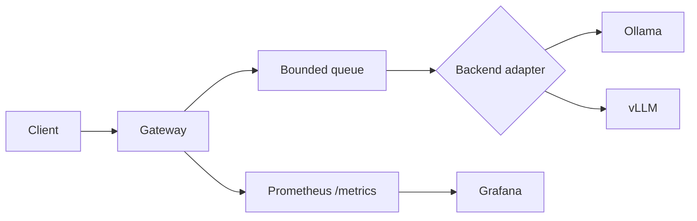

# LLM Chat Gateway

An OpenAI-compatible FastAPI gateway that puts bounded concurrency, rate limiting, metrics, and request cancellation in front of Ollama or vLLM.

[](https://github.com/Hassnain2003/llm-chat/actions/workflows/ci.yml)
[](https://www.python.org/)
[](LICENSE)

## 60-second quick start

Requirements: Python 3.11+, Docker Compose, and an Ollama model if you run the local backend yourself.

```bash
git clone https://github.com/Hassnain2003/llm-chat.git
cd llm-chat
pip install -r requirements.txt
make test
```

Run the gateway against a local Ollama instance:

```bash
MODEL_BACKEND_URL=http://localhost:11434 MODEL_NAME=tinyllama \
  uvicorn gateway.main:app --host 0.0.0.0 --port 8080
```

Then call the OpenAI-compatible endpoint:

```bash
curl -s http://localhost:8080/v1/chat/completions \
  -H 'Content-Type: application/json' \
  -d '{"model":"tinyllama","messages":[{"role":"user","content":"Say hello."}]}'
```

For the complete local stack (gateway, Ollama, Prometheus, and Grafana), use:

```bash
make dev
```

The gateway is at `http://localhost:8080`, Prometheus at `http://localhost:9090`, and Grafana at `http://localhost:3000` (`admin`/`admin`). The Compose Ollama service does not automatically download a model; pull the configured model with `docker compose exec ollama ollama pull tinyllama`.

## What is implemented

- OpenAI-compatible `POST /v1/chat/completions` for non-streaming and SSE streaming responses.
- Ollama and vLLM request adapters selected by `BACKEND_TYPE`.
- A bounded in-process request queue. Full capacity returns `503` with `Retry-After`.
- Token-bucket rate limiting: configured API keys use their own limits; requests without a configured key use the client IP fallback.
- `Retry-After` on rate-limit responses, request IDs in `X-Request-ID`, and JSON request-completion logs.
- Request timeout and client-disconnect cancellation, with queue-slot cleanup.
- Prometheus metrics at `/metrics`, including queue depth, cancellation/timeout counts, time-to-first-token, and the latest streaming tokens/sec.
- `/health`, `/ready`, and `/queue/status` endpoints.
- Helm templates for CPU/Ollama and GPU/vLLM deployment, raw Kubernetes manifests, and Terraform for the optional EKS path.

### API-key configuration

`API_KEYS` is a JSON object mapping keys to requests per minute:

```bash
API_KEYS='{"reviewer-key":30,"service-key":60}' \
  uvicorn gateway.main:app --host 0.0.0.0 --port 8080
```

Use either `X-API-Key: reviewer-key` or `Authorization: Bearer reviewer-key`. An unknown key is treated as an IP-fallback request; this project does not provide user provisioning or persistent distributed rate-limit storage.

### Streaming

```bash
curl -N -s http://localhost:8080/v1/chat/completions \
  -H 'Content-Type: application/json' \
  -d '{"model":"tinyllama","stream":true,"messages":[{"role":"user","content":"Count to three."}]}'
```

## Architecture



The gateway listens on pod port `8080`. Kubernetes Services expose it on port `80` and name the target port `http`; the ServiceMonitor scrapes that named service port at `/metrics`.

See [ARCHITECTURE.md](ARCHITECTURE.md) for the design decisions and known limitations.

## Local Kubernetes

The no-cloud path uses kind (or an equivalent local Kubernetes cluster):

```bash
make kind-up
make kind-deploy
```

The EKS/GPU path is optional:

```bash
helm upgrade --install llm-chat ./chart \
  -f chart/values.yaml -f chart/values-gpu.yaml
```

The default Helm values use a 60 requests-per-minute limit and port `8080`. Local overrides use the same limit:

```bash
helm upgrade --install llm-chat ./chart -f chart/values-local.yaml
```

## Benchmarks

No benchmark numbers are committed. Run `make loadtest` only when the gateway and model are available; it runs the 10-, 50-, and 100-concurrent-user k6 scenarios and writes the command output to `docs/results.md`.

| Concurrent users | Requests/sec | p95 latency | Error rate |
|---:|---:|---:|---:|
| 10 | TODO - run `make loadtest` | TODO - run `make loadtest` | TODO - run `make loadtest` |
| 50 | TODO - run `make loadtest` | TODO - run `make loadtest` | TODO - run `make loadtest` |
| 100 | TODO - run `make loadtest` | TODO - run `make loadtest` | TODO - run `make loadtest` |

Hardware: `TODO - record CPU/GPU, RAM, and storage`.

Model: `TODO - record exact model name and quantization`.

## Limitations

- Rate-limit state and queue depth are process-local; multiple replicas do not share them.
- The gateway does not include authentication, model downloads, or persistent request storage.
- The in-process queue bounds work per gateway process, not globally.
- The EKS Terraform and GPU manifests are deployment starting points and still need environment-specific review.
- Grafana screenshots are intentionally left for a real local run in [docs/screenshots](docs/screenshots).

## Roadmap

- Add a shared rate-limit backend for multi-replica deployments.
- Add integration tests that run against disposable Ollama and vLLM-compatible backends.
- Add a documented production ingress/authentication example.
- Fill the benchmark table and add Grafana screenshots from measured runs.

## Acknowledgments

This project was inspired by [lmenta/inferenceforge](https://github.com/lmenta/inferenceforge). The upstream repository did not expose a license in its repository metadata or contain a `LICENSE` file when checked; this project therefore keeps the inspiration attribution but does not copy an upstream license notice. This repository is independently licensed under the MIT License; see [LICENSE](LICENSE).
